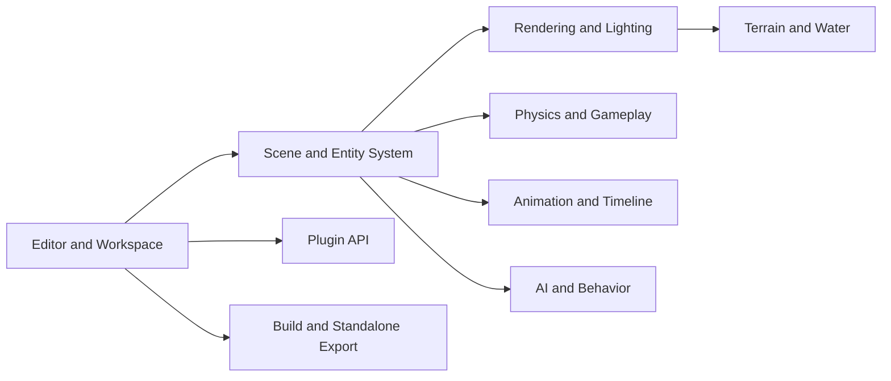
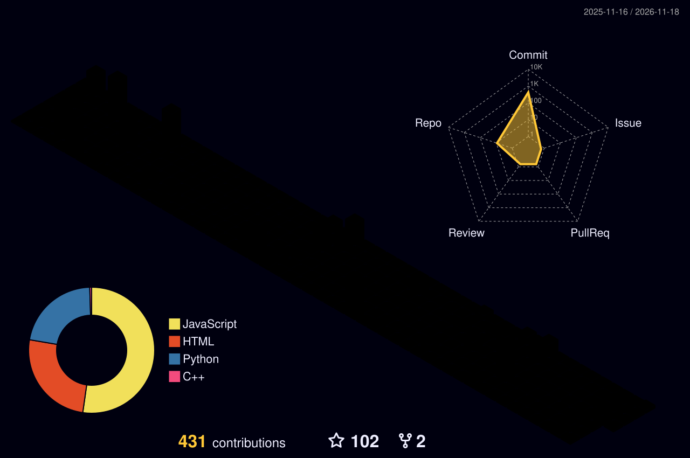

<div align="center">


<a href="https://git.io/typing-svg">
  
</a>

<br/><br/>


<br/><br/>

<a href="https://medelbou3.github.io/My-portfolio/"></a>
<a href="https://linkedin.com/in/elbou-simo-644820282"></a>
<a href="https://x.com/Simo_Elbou3"></a>
<a href="https://www.researchgate.net/profile/Mohamed-El-Bouanani-3"></a>
<a href="https://www.kaggle.com/mohamedelbouanani"></a>
<a href="mailto:simo.elb.2005@gmail.com"></a>

</div>

---

## About Me

I'm a **Computer Science & Artificial Intelligence student** who loves building software that combines **programming, AI, real-time graphics, interactive systems and product design**.

I like creating projects from the ground up and understanding how complex systems work internally, from web apps and algorithms to 3D tools, game-engine systems, animation workflows, rendering experiments and AI research.

My current focus is **SM Engine**, a modular real-time 3D creation and game-development environment based on **Three.js, JavaScript, Electron, WebGL and WebAssembly-oriented tooling**.

| Currently working on | Currently learning | Ask me about |
|:--|:--|:--|
| SM Engine | Rendering, optimization, AI | Three.js, engine architecture, JavaScript |

```text
Current interests
|-- Artificial Intelligence & Machine Learning
|-- Game Engine Architecture
|-- Real-Time 3D Graphics
|-- Rendering & Optimization
|-- Animation Systems
|-- Full-Stack Development
|-- Algorithms & Research
`-- UI / UX for complex creative tools
```

---

## What I'm Building

### SM Engine

<div align="center">
  <a href="https://github.com/MEDELBOU3/SM-Engine">
    
  </a>
</div>

<br/>

**SM Engine** is my largest ongoing engineering project: a modular editor and runtime for real-time 3D creation, modeling, animation, gameplay systems, rendering, terrain, virtual production, scripting, build/export workflows and extensibility.



| Creation | Runtime | Platform |
|:--|:--|:--|
| 3D modeling & sculpting | Physics & gameplay | Plugin architecture |
| Timeline, graph & 2D animation | Player / character architecture | Build & standalone export |
| Terrain & water | AI & behavior systems | Scripting |
| Rendering & lighting | Performance for large scenes | Editor / workspace architecture |

<div align="center">

<a href="https://github.com/MEDELBOU3/SM-Engine"></a>

</div>

---

## Tech Stack

<div align="center">


</div>

<br/>

| Area | Technologies / Tools |
|---|---|
| **Languages** | JavaScript, Python, C++, C, HTML, CSS |
| **3D & Graphics** | Three.js, WebGL, GLSL concepts |
| **Desktop Apps** | Electron |
| **AI / Data** | Python, algorithm experimentation, ML concepts |
| **Web** | Front-end development, interactive web applications |
| **Tools** | Git, GitHub, VS Code, Figma |
| **Engineering Focus** | Engine architecture, animation, rendering, runtime systems, optimization |

---

## Featured Projects

<div align="center">

<a href="https://github.com/MEDELBOU3/SM-Engine">
  
</a>
<a href="https://github.com/MEDELBOU3/AetherStream">
  
</a>

</div>

<table>
<tr>
<td width="50%" valign="top">

### SM Engine

<a href="https://github.com/MEDELBOU3/SM-Engine">
  
</a>

Modular 3D creation and game-development engine focused on editor tooling, real-time graphics, animation, gameplay systems and extensibility.

**Tech:** `JavaScript` / `Three.js` / `Electron` / `WebGL`

</td>
<td width="50%" valign="top">

### AetherStream

<a href="https://github.com/MEDELBOU3/AetherStream">
  
</a>

A media-focused web application built around an interactive streaming-style interface and front-end experience.

**Tech:** `HTML` / `CSS` / `JavaScript`

</td>
</tr>
</table>

<div align="center">

<a href="https://github.com/MEDELBOU3?tab=repositories"></a>

</div>

---

## Research & Technical Exploration

I'm interested in the research side of computer science, especially when an idea can be implemented, tested, measured and compared experimentally.

- Algorithms and heuristics
- Optimization problems
- Artificial intelligence
- Real-time systems
- Rendering techniques
- Performance engineering
- Simulation
- Experimental software design

<div align="center">

<a href="https://www.researchgate.net/profile/Mohamed-El-Bouanani-3"></a>
<a href="https://www.kaggle.com/mohamedelbouanani"></a>

</div>

---

## GitHub Analytics

<div align="center">


<br/>


<br/><br/>


</div>

### Contribution Activity

<div align="center">


</div>

### 3D Contribution Graph

<div align="center">
  
</div>

### Contribution Snake

<div align="center">

<picture>
  <source media="(prefers-color-scheme: dark)" srcset="https://raw.githubusercontent.com/MEDELBOU3/MEDELBOU3/output/github-contribution-grid-snake-dark.svg">
  <source media="(prefers-color-scheme: light)" srcset="https://raw.githubusercontent.com/MEDELBOU3/MEDELBOU3/output/github-contribution-grid-snake.svg">
  
</picture>

</div>

---

## Goals

I want to keep growing as an engineer and eventually work on ambitious products involving **AI, graphics, real-time systems and creative software**.

- Build software used by real people
- Grow SM Engine into a serious technical platform
- Work on advanced AI and graphics systems
- Publish stronger technical and research work
- Collaborate with talented developers around the world
- Build products and companies around meaningful technology
- Keep learning across computer science, design and engineering

---

## Beyond Code

Technology is a big part of my life, but not the only thing I want to experience.

| Formula 1 | Japan |
|:--|:--|
| One of my dreams is to experience an F1 car and the engineering, precision and speed behind motorsport. | A country I'd love to explore for its technology, cities, culture, food, design and landscapes. |
| **Dream:** feel it from the cockpit | **Wishlist:** Tokyo, Kyoto, Osaka, Mount Fuji |

---

## Connect With Me

<div align="center">

<a href="https://medelbou3.github.io/My-portfolio/"></a>
<a href="https://linkedin.com/in/elbou-simo-644820282"></a>
<a href="https://x.com/Simo_Elbou3"></a>
<a href="mailto:simo.elb.2005@gmail.com"></a>

</div>

---

## Support

<div align="center">

If you enjoy my open-source work, starring a repository or sharing feedback is already a great way to support it.

<br/><br/>

<a href="https://www.buymeacoffee.com/simolbou3"></a>
<a href="https://paypal.me/simolbou3"></a>
<a href="https://github.com/sponsors/MEDELBOU3"></a>

<br/><br/>

### Thanks for visiting

**I like building difficult things, understanding how they work, and improving them one system at a time.**


</div>
